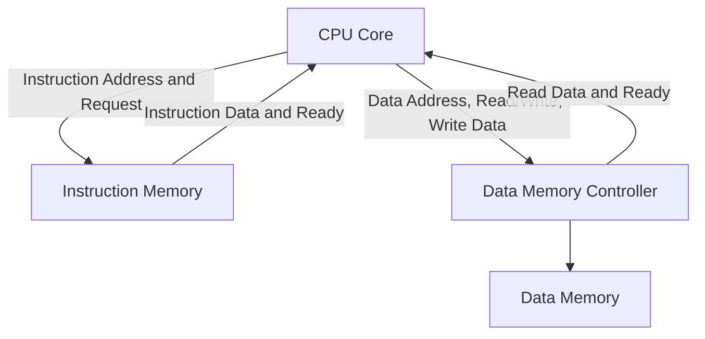
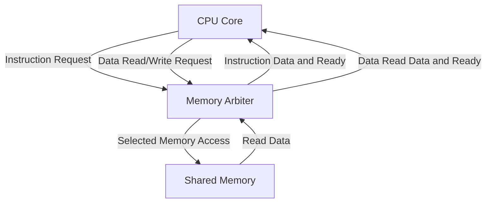

# M5 - Architecture Block Diagrams

## 1. Harvard Architecture

The Harvard architecture uses separate instruction and data memory paths. This allows instruction fetching and data access to take place independently.

## 2. Shared Memory Architecture

The shared architecture uses one memory interface for both instructions and data. The arbiter gives priority to data accesses when instruction fetching and data access conflict. Instruction fetching is delayed during such conflicts.

## 3. Architecture Comparison

| Feature | Harvard | Shared Memory |
|---|---|---|
| Instruction memory | Separate | Shared |
| Data memory | Separate | Shared |
| Memory access | Independent paths | Arbitration required |
| Instruction/data conflict | Avoided by separate paths | Possible |
| Expected stalls | Lower | Higher during conflicts |
